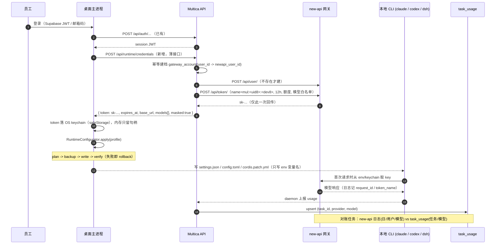

# Runtime Configurator 设计 + New API 集成评估

2026-11-10 · R1 · 状态：设计 + 薄骨架（未接真实写盘、未改任何现有业务逻辑）

目标只有一句：**员工装完客户端、登录一次，本机 Claude Code / Codex / DSH 就已经对着公司模型网关，且手里那把钥匙是他个人的、可撤销的、有额度的。** 公司上游 Key 永远不下发。

本文所有"现状"都来自本次实际读过的文件（行号见引用），没读过的一律标 `UNKNOWN`。

---

## 0. 三条结论（先看这个）

1. **凭据流不该新造一套**：现有 `mat_` 任务令牌（24h、绑定 agent+task、claim 时签发、`MULTICA_TOKEN` 注入）已经解决了"任务级最小权限"。缺的是**人级、长期、可撤销的网关 key**：设计上补一枚 `T1`（每用户一枚 new-api key，长期有效、服务端可吊销/重签），三级凭据 `T0 > T1 > T2` 分层，T0 永不离开网关。**T1 就是员工机器上的 LLM API key**，不设到期时间——它就是"公司发给这个人的模型凭据"，不是会话凭据；登录态仍走账号密码，两者互不绑定。
2. **配置写入必须"意图与落盘分离"**：writer 只产出 `PlannedFile`（含路径、最小字段、managed region），落盘由注入的 `ConfiguratorFs` 完成。这样"绝不打印密钥"变成类型性质（`SecretRef` 只能命名、不能承载），而不是 code review 习惯；同时整套编排可以在没有临时目录的情况下单测。
3. **New API：引入，但边界固定** —— 独立数据库、独立账本、纯 API 集成、不共表；`task_usage` 仍是费用归因权威，new-api 日志只作对账来源。**网关不在任务关键路径上**：公司 key 失效（401/402/403/429/超时）时按固定顺序降级 —— 先用**员工自己在设备上配置的个人 key**，没有才失败并给出可操作提示；这段时间的用量记为 `unattributed`。

---

## 1. 凭据流

### 1.1 三级凭据与红线

| 级别 | 是什么 | 谁持有 | 生命周期 | 现状 / 新增 |
|---|---|---|---|---|
| **T0** 上游 provider key（Anthropic / OpenAI / DeepSeek 官方 key） | 公司真金白银的凭据 | 只在 new-api 渠道配置（`SQL_DSN` 那套库/env） | 人工轮换 | **新增（外置）**，Multica 库中零副本 |
| **T1** 网关 API key（`sk-...`，new-api 签发） | 员工个人凭据（就是这台机器上的 LLM API key） | 服务端签发 → 桌面主进程 → OS keychain | **长期有效**；手动轮换/吊销；与登录态解耦 | **新增** |
| **T2** 任务令牌（`mat_...`） | 单个任务的 API 凭据 | 服务端 claim 时签发 → daemon 环境变量 | 24h（`daemon.go:4421`） | **已有，不动** |

红线的实现定义：**Multica 的任何 DTO / 任何表 / 任何磁盘文件都不出现 T0**。T0 的存在位置是 new-api 的渠道配置，Multica 对它只有"一个 base_url"的认知。

### 1.2 登录 → 签发 → 下发 → 注入 → 失效



关键点逐条：

- **签发是"人级"，不是"任务级"**。任务级令牌已有（`mat_`），再叠一层任务级网关令牌会让 CLI 长会话（Codex thread、DSH session）在任务结束后失去凭据 —— 那正是现在 `auth.json` 被 symlink 共享、由 daemon 每次 Prepare 重新指向的原因（`execenv/codex_home.go:20-47` 的注释明确说"once-stale auth.json never refreshes"）。所以 T1 跟"人 + 设备"绑定。
- **有效期：长期，不设自动到期**（2026-11-10 定稿）。T1 就是发给这个人的 LLM API key，和登录态解耦：登录仍然用账号密码，登录过期不会让 key 失效，key 失效也不影响登录。生命周期只有三种变化：(a) 管理员/本人手动**轮换**（重签，旧 key 立即禁用）；(b) 成员被移除、设备解绑时**吊销**；(c) 疑似泄漏的批量吊销。没有"滑动续期"这回事——省掉续期路径，也就省掉"续期把短窗口无限延长"的漏洞面。
- **可撤销**：三条路径 —— (a) 登出时可选"吊销这台设备的 key"（本地 keychain 一定删除）；(b) 成员被移除 / 设备解绑时服务端批量吊销该 `user_id` 前缀的全部 key；(c) 网关侧一键禁用（new-api 令牌页支持启停）。撤销生效窗口 = new-api 的缓存同步周期（`SYNC_FREQUENCY`，默认 60s）。
- **降级（用户要求，V1 必做）**：公司 key 出现 `401/402/403/429` 或连续超时时，Configurator 按固定顺序重试 —— ① 公司 key；② **员工自己在设备上配置的个人 key**（设置页可填，存 keychain，标注"仅本机"）；③ 都没有则失败，并在 UI 写明"公司额度不可用，请在设置里填自己的 Key 或联系管理员"。每次运行记录 `credential_source ∈ {company, personal, none}`，便于事后归因；personal 用量的费用不记公司账。
- **客户端怎么拿**：只回传一次，且**只在主进程**。renderer 拿不到 T1 —— 这条沿用现有 `AuthSessionCoordinator` 的边界（`auth-session-coordinator.ts`：跨窗口只比对 user id，token 不走 renderer）。
- **任务结束怎么失效**：T1 **不随任务失效**（它不属于任务）。任务结束真正要收口的是 `mat_`：现有 claim 在任务终态时 best-effort revoke（`handler/daemon.go:5723` 注释"Best-effort revoke of the mat_ task token minted at claim"）。要补的是"任务结束 → 清掉该任务进程环境里残留的 T1 派生物"：daemon 侧本来就不给 agent 传 T1（见下条），所以这块实际是 0 工作，只需要一条回归测试钉住。

### 1.3 每个 CLI 的注入点与最小字段

| Target | 文件 | 我们拥有的最小字段 | key 怎么进去 | 依据 |
|---|---|---|---|---|
| **Claude Code** | `~/.claude/settings.json` | `morechat.env.ANTHROPIC_BASE_URL`、`morechat.env.ANTHROPIC_MODEL`、`morechat.apiKeyHelper` | **不落盘**：`apiKeyHelper` 指向 helper 可执行文件，运行时从 keychain 读 | daemon 自己也读这个文件（`claude_plugins.go:39`），且 claude backend 用 `ANTHROPIC_BASE_URL` 是否存在于 env 来决定用量记账路径（`pkg/agent/claude.go:497`） |
| **Codex** | `~/.codex/config.toml` | `model`、`model_provider`、`[model_providers.morechat]{name,base_url,env_key,wire_api}` | **不落盘**：`env_key = "MULTICA_RELAY_KEY"`，值在 spawn 时注入 | daemon 每任务把共享 `config.toml` 复制进 `$CODEX_HOME` 再叠加自己的块，`auth.json` 走 symlink（`execenv/codex_home.go:20-47`） |
| **DSH** | `$DSH_HOME/cordis.patch.yml`（默认 `~/.dsh`） | provider 条目：`baseURL`、`apiKeyEnv`、`defaultModel` | **不落盘**：`apiKeyEnv` 是 credential-ref，DSH 自己从 env 读 | `dsh.go:119-121` 启动参数、`dsh_profile.go:117-131` profile 路径、DSH bundle 内 `cordis.yml` 头部写明"Edit cordis.patch.yml, not this file"、`dsh-llm-deepseek-api-key` 的 config 用 `apiKeyEnv`（默认 `DEEPSEEK_API_KEY`） |

三个 target 的共同结论：**配置文件里只有"变量名"，没有"变量值"**。这不是风格，是让 `git diff`、`~/.claude` 目录分享、bug report 附件都不能泄密。

补一条对桌面端很关键的实现约束：daemon 跑任务时给 agent 的环境是 `taskMulticaEnvironment()` 造的白名单（`daemon.go:179-229`），`custom_env` 会叠加上去，但被 `isBlockedEnvKey` 挡掉 `MULTICA_*` / `HOME` / `PATH` / `CODEX_HOME` 等（`daemon.go:10882`）。`ANTHROPIC_*` / `OPENAI_*` 不在黑名单里 —— 也就是说 **daemon 跑的任务可以通过 agent 的 `custom_env` 拿到同一个 base_url**（值层面），而员工本地手跑 CLI 走的是配置文件。两条路径必须由**同一个 Profile** 渲染，否则会出现"我本地能跑、任务里跑不了"的经典分裂。这是 Configurator 存在的第二个理由。

### 1.4 "公司 Key 不下发"在实现层怎么保证（五层，缺一层就漏）

| 层 | 机制 | 落点 | 现状 |
|---|---|---|---|
| L1 数据层 | 没有任何列存放 T0；`gateway_account` 只存 `user_id ↔ newapi_user_id` 映射 | migration | 新增 |
| L2 接口层 | 无 DTO 字段承载 T0；T1 只在**首次签发**响应里出现，此后任何读都返回 `***` 哨兵 | `POST /api/runtime/credentials` | 模式已存在：`runtimeConfigGatewayTokenMask` + `preserveMaskedGatewayToken`（`handler/agent.go:145-152, 247-300`） |
| L3 客户端层 | writer 只接受 `SecretRef`（`{kind:"env",name}` / `{kind:"keychain",...}`），类型上无法承载明文；`assertNoSecretLiteral()` 在渲染后断言无 `sk-/mat_/mul_` 形态 | `runtime-configurator/writers/writer.ts` | 本轮已实现 |
| L4 日志层 | 编排器只记录 `path` + `content_sha256_8`，绝不记录 content；服务端沿用 `pkg/redact`，补 `sk-[A-Za-z0-9_-]{8,}` 规则 | `runtime-configurator/index.ts` / `pkg/redact` | 客户端已实现；redact 规则待补 |
| L5 回归层 | CI 断言：(a) 任意 `/api/**` JSON 响应体内不含 `sk-`；(b) 任意 `PlannedFile.content` 不含 token 形态；(c) 任意 `runtime_config` 读回里 token 字段为 `***` | `*_test.go` / `*.test.ts` | 参照 `daemon_runtime_access_test.go:379-380`"resp carries credentials … want none"的写法 |

顺带一条与凭据相关的**现状缺陷**（不在本次范围，但会咬人）：`supabaseauth/verifier.go:18-40` 把 Supabase project 与 `sb_publishable_` 前缀硬编码在代码里，而 `.env.example` 里**根本没有 `SUPABASE_*`**（只有 `RESEND_*`）。也就是说自建部署的运维在 `.env.example` 里找不到该变量，猜错就静默降级成 `FromEnv() == nil`。要么把它补进 `.env.example`，要么在启动日志里明确打一行"未配置 supabase 校验，外部登录关闭"。

---

## 2. 配置写入

### 2.1 写入协议（一个形状，不许有第二个）

```
plan → backup → write → verify → (任一失败) rollback
```

| 步骤 | 语义 | 失败后果 |
|---|---|---|
| `plan` | 纯函数，零 IO。按 target 收集 `PlannedFile`（路径、格式、mode、managed region、内容） | `plan-empty` → 直接返回，不碰盘 |
| `backup` | 在写任何字节之前，把每个待触碰路径的**字节级原状**（含"原本不存在"）复制到 `~/.multica/profiles/desktop-<host>/runtime-config-backups/<applyId>/` | 备份失败 ⇒ 整个 apply 中止，**零写入**。这条不许软化 |
| `write` | `writeFileAtomic(path, content, mode)`：同目录临时文件 → fsync → rename。禁止 "truncate 后写" | 任一失败 ⇒ 回滚已写路径 |
| `verify` | 重新解析**读回的内容**（JSON / TOML / YAML 真解析，不是子串匹配），比对受管字段与 mode | 失败 ⇒ 回滚**全部**本次写入（含验证通过的），半配置状态比旧状态更坏 |
| `rollback` | 按备份恢复：改回原内容、重建、或删除我们新建的文件 | 回滚自身失败 ⇒ `rollback-failed` + 告警（这是唯一必须惊动人的分支） |

三个易被忽略的正确性点：

1. **幂等**：`merge(plan, 现状) === 现状` 时跳过 —— 崩溃后重跑是 no-op，不会再造一份备份、不会刷新 mtime 让 Codex 误判配置变更。
2. **merge 三种模式**：`replace`（文件是我们的）、`json-merge`（按 key 深合并，只吃我们那个命名空间）、`managed-region`（只替换标记之间那段，标记外逐字节保留）。用户手工加的 MCP server、sandbox 设置、注释都在标记外，不会被我们吃掉。
3. **mode 0600**：凡是"可能承载凭据"的文件一律 0600 —— 即使当前内容没有密钥，未来某次 fallback 写进去也不至于裸奔。daemon 对 per-task `config.toml` 也做同样处理（`pkg/agent/codex.go:681` 的 `chmod 0600`）。

### 2.2 每个 target 的落盘细节

| Target | 备份方式 | 回滚 | 幂等键 | 特殊风险 |
|---|---|---|---|---|
| Claude Code | 整个 `settings.json` 复制 | 字节还原；文件原本不存在则删除 | `morechat` 子树序列化后的 sha256 | 用户可能正开着编辑器；且 daemon 也读这个文件，写到一半（非原子）会直接让 Claude provider 掉线。`verify` 必须真 JSON.parse |
| Codex | `config.toml` + `auth.json`（**auth.json 只备份不写**） | `config.toml` 字节还原；`auth.json` 只在"回滚需要重建目录"时参与 | managed region 内容 sha256 | 不能动 `auth.json`（ChatGPT OAuth）；region 外是用户的 TOML，注释要保留；per-task 副本每次 Prepare 重建，所以我们的写入天然被继承 |
| DSH | `cordis.patch.yml` | 字节还原 / 删除 | region sha256 | **不许碰** `profiles/multica/cordis.yml`（安装器生成，注释写着别编辑）；provider 结构见 §5，已按安装内置的 `dsh-llm-pi-ai` 文档核实 1 |

### 2.3 参考 cc-switch 的部分 / 不引入的部分

参考（都是数据模型层面的）：

- provider-profile 抽象：一个 profile = `{id, 名称, base_url, 凭据引用, 模型列表, 默认模型}` —— 与 cc-switch 的"provider 卡片"结构同构，因此员工心智可以直接迁移；
- "同一 target 只有一个 active provider"的切换语义（Claude Code / Codex 属于 switch 模式），正好对上我们"一个人一个当前网关"的事实；
- 冲突处理：切换 provider 时对受管字段做整体替换、对非受管字段保留 —— 与本文 `managed-region` / `json-merge` 一致。

**不引入**：cc-switch 的本地路由/格式转换/熔断（`llms.txt` 里 "Local Routing that converts between Anthropic, OpenAI, and Gemini API formats … automatic failover, circuit breakers"）。理由是那套东西一旦进客户端，就多出一个"我们自己写的代理"要维护、要背锅、要在每个平台上被防火墙和证书策略伺候，而**格式转换 + 故障转移本来就是 new-api/LiteLLM 的职责**。客户端只做"把配置写对"，不做"代理流量"。

### 2.4 失败模式表

| 现象 | 分类 | 处理 |
|---|---|---|
| 备份目录不可写（磁盘满/权限） | 环境 | 中止，零写入，UI 提示"未改动任何配置" |
| `settings.json` 被用户改坏（非法 JSON） | 用户数据 | 不 merge，整体替换为受管内容，并把坏文件存进备份（可一键找回） |
| 写到一半进程被杀 | 运行时 | 原子 rename 保证旧内容或新内容二者之一；下次 apply 靠幂等判定收敛 |
| verify 失败 | 逻辑/格式漂移 | 全量回滚 + 上报（带 `failures`，不带内容） |
| 两个窗口同时 apply | 并发 | 单飞锁（`app.requestSingleInstanceLock` 粒度不够，要在配置器内加 apply 互斥） |

---

## 3. New API 集成评估

### 3.1 结论

**引入（是）。** 作为公司模型网关，与你给出的定位一致：独立数据库、独立账本、API 集成、不共表。

但加两个硬条件，否则不上：

- **条件 A：口径先定。** `task_usage` 是费用归因权威这件事必须写进运维文档，且对账任务只产出"差异报告"，不允许反向修改 `task_usage`。
- **条件 B：网关不在任务关键路径。** 任何"new-api 不可用 ⇒ 任务不能跑"的实现都被否决（见 §3.7）。

不上 new-api 的逃生口（保留同一 Profile 抽象即可 30 天内切换）：团队 < 5 人、只用单一上游官方 key、不需要按人限额 —— 此时直接把 `base_url` 指向上游、把 `apiKeyRef` 指向个人 key，Configurator 一行不改。

### 3.2 部署形态

| 项 | 取值 | 说明 |
|---|---|---|
| 数据库 | `SQL_DSN=postgresql://…` 指向**独立库** | 官方推荐生产用 PostgreSQL；不设 `SQL_DSN` 会退到 SQLite（单机玩具）。**不与 Multica 同库同 schema** |
| 日志库 | 可选 `LOG_SQL_DSN` 再拆一个库 | 日志是最容易膨胀的表；拆开后 Multica 的对账查询只读它，主库不被日志拖慢 |
| 缓存 | `REDIS_CONN_STRING`（可选） | 多节点必须共享 DB + 同一 `SESSION_SECRET`；令牌撤销的生效窗口受 `SYNC_FREQUENCY` 影响 |
| 集成方式 | 只有 HTTP API + 只读日志 | 不共享表、不共享连接串、不跨库 join |

### 3.3 注册时是否同步建 new-api 用户：是，且必须幂等

| 步骤 | 动作 | 幂等/重试策略 |
|---|---|---|
| 1 | 本地建 `gateway_account(user_id PK, newapi_user_id, username, created_at, disabled_at)` | 一次事务 |
| 2 | `POST /api/user/`（管理员权限）建用户，`username = morechat:<user_uuid>` | "已存在"视作成功；随后 `GET /api/user/search?keyword=<username>` 反查 id 落库。new-api 的 `username` 没有唯一约束保证时，用 `morechat:` 前缀 + 精确匹配兜底 |
| 3 | 写入 `newapi_user_id` | 唯一索引防并发双建 |
| 4 | 失败 | **不回滚注册**：Multica 账号先成立，网关侧延迟补偿（后台 job，指数退避，最长 24h）。员工可以用"个人上游凭据"模式先用起来 |

要点：**注册主流程不因为网关失败而失败**。这是 §3.7 降级设计的前提。

### 3.4 token 生命周期

| 事件 | 动作 | 备注 |
|---|---|---|
| 登录 / 刷新 | `POST /api/token/`，`name = mul:<uid8>:<dev8>`，`expired_time = now+12h`，`remain_quota = 套餐额度`，`model_limits = 白名单`，`group = <套餐组>` | 名字编码了用户与设备，是后续对账的主键来源（§3.6） |
| 静默续期 | 距到期 < 60min 时，先建新 token 再删旧 token（先建后删，避免窗口期无凭据） | 同一 `applyId` 语义：新 token 生效才删旧的 |
| 登出 / 设备解绑 | `DELETE /api/token/:id` + keychain 删除 | 立即失效受 new-api 缓存周期约束 |
| 成员移除 / 停用 | 按 `name` 前缀批删 + `PUT /api/user/` 禁用 | 兜底：禁用用户即所有 token 失效 |
| 硬上限 | 无自动到期；轮换/吊销由人触发 | key 长期有效，出问题靠"可吊销 + 可轮换 + 泄漏告警"而非短窗口 |
| 泄漏处置 | 一键吊销 + 白名单外模型拒绝 + 网关侧看 `token_name` 定位影响面 | new-api 令牌支持 IP 白名单，远程办公场景需谨慎启用 |

### 3.5 额度与模型白名单怎么下发

| 维度 | 权威在哪 | 怎么到网关 | 怎么到客户端 |
|---|---|---|---|
| 模型白名单 | Multica（套餐/角色） | 签发 token 时写 `model_limits` | Profile 的 `models[]` + `defaultModel`，**仅用于 UI 与写入纠错** |
| 额度 | Multica 套餐 + 网关用量 | token `remain_quota`（+ 必要时用户级额度） | 客户端只显示"剩余"，不参与决策 |
| 分组/渠道 | 网关 | token `group` | 不下发 |

一句话：**客户端拿到的白名单是"提示"，不是"权限"**。真正的权限在网关令牌上，客户端改配置也越不过去 —— 这正是"不共表 + 只发个人令牌"的收益。

### 3.6 对账键：用什么、为什么不能用 request id

先说清一个事实：**我们看不到 CLI 发出的 HTTP 请求**。Claude Code / Codex / DSH 直接连网关，Multica 服务端不在链路上，所以 new-api 的 `request_id` 再好也 join 不到我们这边。而且 new-api 目前的本地 `request_id` 是它自己生成的，只通过响应头 `X-Oneapi-Request-Id` 回给调用方；"把本地 request_id 转发到上游 / 接受客户端注入的关联 id"仍是未合并的需求（new-api issue #6512）。所以：

| 候选键 | 可用性 | 结论 |
|---|---|---|
| new-api log `request_id` | 只在网关内部有意义；调用方是第三方 CLI，我们拿不到 | **不做对账键**，只作争议排查（让网关按 request_id 找那一条） |
| new-api log `token_name` | 是我们签发的，名字里编码了 `<uid8>:<dev8>` | **主键**（人 + 设备粒度） |
| new-api log `username` | 由我们建的用户名 `morechat:<uuid>` | 兜底键（token 被删后日志仍在，username 还在） |
| 时间窗 + `model_name` + `group` | 粒度粗，但抗标识缺失 | 三级兜底 |
| Multica `task_usage`（`task_id, provider, model`，migration 032 的唯一键） | 任务/agent/issue/workspace 粒度 | **费用归因权威**，不被对账修改 |

对账口径：

```
左：new-api 日志按 (user, model, UTC day) 聚合 quota
右：task_usage join agent_task_queue（task → agent → workspace → owner）
   按 (owner_user, model, UTC day) 聚合
差异 = 左 - 右，记为 gateway_unattributed（本地直连 / 旁路调用 / 模型别名未映射）
```

三个必须写进实现的坑：

1. **模型别名**：网关可能对外暴露 `claude-sonnet-4-5`，上游回报的是 `claude-sonnet-4-5-20250929`，两边直接 join 会产生 100% 假差异。必须维护 `model_alias` 映射表，并在差异报告里把"未映射模型"单列。
2. **UTC 边界**：`task_usage_hourly` 是按 UTC 小时桶聚合的（`task_usage.sql` 的 rollup 查询明确用 UTC 桶 + 查看时区切片），对账也走 UTC 日，容忍 ±1 天的边界漂移，不要按本地日。
3. **成本单位**：`task_usage` 用 `cost_usd_ticks`（1e-10 USD）与 `credits_micros`，new-api 用 `quota`（其内部额度单位）。两者换算系数必须显式配、显式记版本，否则"对上了"只是巧合。

如果将来真要**任务粒度**的网关日志：唯一办法是每任务签发一枚网关 token（name 里带 `task_id`）。V1 不做，理由：CLI 会话寿命 > 任务寿命（thread 续跑、`--resume`），任务级令牌会在任务结束时把仍在跑的会话打死；且 token 数量爆炸（每人每任务一枚）。V2 可选方案是"长会话用 T1、短任务额外发一枚 T2g"，代价是两套路径都要维护。

### 3.7 失败降级

| 故障 | 任务还能跑吗 | 行为 |
|---|---|---|
| 签发接口（我们的 API）挂了 | 能（已登录且 T1 未过期） | 本地 T1 继续用；到期后按条件切 `upstream` |
| new-api 管理 API 挂了 | **能** | 只影响签发/续期/吊销；已在手的 T1 照用 |
| new-api 整体不可用 | **能，但换凭据** | Configurator 切到 `upstream` profile（用户自己的 key / ChatGPT 订阅），一次 apply，UI 明示"当前用量不计入公司账本" |
| 网关上游 5xx / 限流 | 能（网关内部重试/换渠道） | 这是 new-api 自身职责；超出后与"上游厂商挂了"同类 |
| 令牌被误吊销 | 能 | 续期失败 → 明确报错"凭据已失效，请重新登录"，不静默降级（静默降级会让员工以为在用公司额度，实际在烧自己的钱） |

**红线**：new-api 加入后，`tasks still run` 必须有一条集成测试证明 —— 断掉 new-api，跑一个任务，assert 任务 completed 且 `task_usage` 有行。

### 3.8 与 LiteLLM 的取舍（各一句）

- **new-api**：多租户面板 + 令牌额度/模型白名单/分组 + 管理 API 齐全 + PostgreSQL，本质是"给一群人发可限额的 key"，运营视角友好。
- **LiteLLM**：Python proxy，把 routing / fallback / 负载均衡 / 逐请求成本追踪 / OTel 当一等公民，工程视角友好，但自助多租户面板弱。
- **什么时候该换 LiteLLM**：出现"同一请求需要跨 provider 自动降级或按权重分流"、"需要逐请求级成本归因而非日级对账"、"需要 OTel 全链路"这三者任一 —— 那时 new-api 的日级日志 + token_name 对账就不够用了。反过来，只要诉求还是"发 key + 限额 + 对账"，留在 new-api。

### 3.9 决策表

| 维度 | 方案 A：new-api | 方案 B：LiteLLM | 方案 C：不引入网关（客户端直连上游） | 本次结论 |
|---|---|---|---|---|
| 给员工发个人可撤销 key | 原生（令牌页 + 管理 API） | 需自建（virtual key 有，面板弱） | 做不到（只能用公司 key 或个人 key） | **A** |
| 额度 / 模型白名单 | 令牌级 `remain_quota` + `model_limits` | key 级 budget + 模型白名单 | 无 | **A** |
| 独立账本、不共表 | 是（独立 `SQL_DSN`） | 是 | N/A | **A** |
| 对账键可得性 | `token_name`（我们命名） | 有 request 级日志 + 元数据透传，更强 | 无 | A 够用 |
| 路由/熔断/多上游 | 有（渠道 + 重试），配置导向 | 更强（一等公民） | 无 | A 够用 |
| 中文运营面板 | 有 | 弱 | 无 | **A** |
| 运维成本 | 一个 Go 二进制 + PG | Python 服务 + PG | 0 | C 最低 |
| 切换成本（保留 Profile 抽象） | — | 换 base_url + 换管理 API 适配层 | — | 低 |
| **适用触发条件** | 员工 > 5 或需要按人限额/审计 | 需要请求级归因或跨 provider 自动降级 | 员工 ≤ 5 且单一上游 | 现阶段选 **A**，保留 C 作逃生口 |

---

## 4. 骨架与验证

新增（未接真实写盘、未改任何现有业务逻辑）：

| 文件 | 内容 |
|---|---|
| `apps/desktop/src/main/runtime-configurator/types.ts` | `TargetId`/`ProviderKind`/`SecretRef`/`ProviderProfile`/`TargetPaths`/`RuntimeProfile`/`PlannedFile`/`VerifyResult`/`ApplyOutcome` |
| `.../writers/writer.ts` | `RuntimeTargetWriter` 接口、managed region 常量、`assertNoSecretLiteral()` |
| `.../writers/claude-code.ts` | `plan()` 真实渲染（JSON 子树）+ `verify()` 签名与 TODO |
| `.../writers/codex.ts` | `plan()` 真实渲染（TOML managed region）+ `verify()` TODO |
| `.../writers/dsh.ts` | `plan()` 真实渲染（YAML patch 层）+ `verify()` TODO |
| `.../index.ts` | `createRuntimeConfigurator()`：`plan/apply/revert`，`mergeFile()`（replace / json-merge / managed-region），日志只出 path + hash8 |

刻意不做：不 import `fs`、不实现 `ConfiguratorFs`/`BackupStore` 的具体适配器 —— 这样"骨架里不可能写盘"是可验证的性质，而不是承诺。

---

## 5. 未决问题

1. **DSH provider 的结构（已解决）**：本机安装的 harness 文档给出了权威答案——不存在 `llm-<id>:` 这样的顶层映射；要把网关接进来，是**挂载 `@deepseek-ai/dsh-llm-pi-ai` 插件**并给它一个 `providers` 字典，字典的键就是请求用 `GenerateOptions.provider` 选择的路由名：
   ```yaml
   - id: llm-pi-ai-morechat
     name: '@deepseek-ai/dsh-llm-pi-ai'
     config:
       providers:
         morechat:
           api: openai-completions
           baseURL: '<网关地址>/v1'
           apiKeyEnv: MORECHAT_GATEWAY_TOKEN   # credential-ref，文件里不落密钥
           models:
             - id: '<模型 id>'
   ```
   证据：`@deepseek-ai/dsh-llm-pi-ai/README.zh.md` §配置（"`providers` 字典就是整个配置面：每个键都是请求用 `GenerateOptions.provider` 选择的提供方路由名"，`apiKeyEnv` 为按请求解析的凭据引用）。DSH 侧 `dsh.go` 的 `provider/model` 选择因此必须与这里的键一致；写错的表现是 `--list-models` 空目录。`writers/dsh.ts` 已按此结构输出。
2. **Claude Code 的 `apiKeyHelper` 与 `env.ANTHROPIC_AUTH_TOKEN`**：默认走 helper（文件无密钥）；若目标版本不支持 helper，回退为 0600 文件内明文 `ANTHROPIC_AUTH_TOKEN`，需要按最低支持的 Claude Code 版本实测确认后再定默认值。
3. **new-api 用户名唯一性**：`POST /api/user/` 重名是否 4xx、`search` 是否精确匹配，需按实际版本验证一轮（已在 §3.3 写了兜底，但没实测）。
4. **`sk-` 前缀与客户端识别**：如果某些 CLI 对 `base_url` + `env_key` 组合有额外要求（例如必须 `wire_api = "responses"` 才走 Responses 协议），需要按模型清单实测。
5. **`gateway_account` 表与计费归属**：`task_usage` 目前只能 join 到 `agent_task_queue` 的 owner/agent，无法直接得到"哪个员工在用前台 CLI 个人调用"—— 这部分只能靠 new-api 侧对账，缺口已归入 `gateway_unattributed`。是否要为此新增 `usage_source` 维度（`task` / `local-cli`），需要产品决定。
6. **`.env.example` 缺 `SUPABASE_URL` / `SUPABASE_PUBLISHABLE_KEY`**（见 §1.4 末），自建部署文档与代码不一致，建议单独一个小 PR 修。
